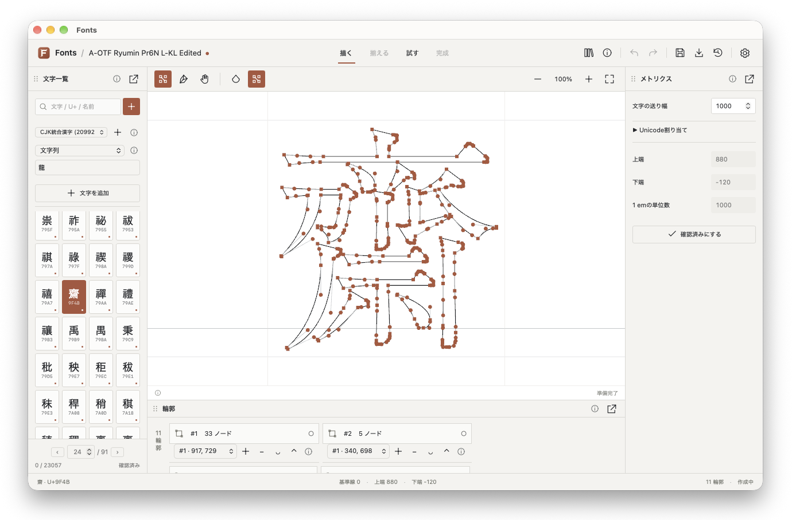

# Fonts



Tauri 2 + Rustで作るフォント制作アプリ。UIはWebView、文書・編集状態はRust、輪郭描画はRustのwgpu/Metalが担当します。

現在はmacOSで起動・編集でき、静的TTF・OTF等の入出力に対応しています。現在の優先項目は[ROADMAP](docs/ROADMAP.md)を参照してください。

## 起動

```sh
npm ci
npm run tauri dev
```

この作業環境では依存パッケージをローカルへコピー済みなので、そのまま `npm run tauri dev` で起動できます。LumaPaint checkoutやFontForge cloneは不要です。Node.js 22.13以降、Rust toolchain、macOSのXcode Command Line Toolsを使用します。

## macOSアプリのビルド

```sh
npm run tauri build -- --debug --bundles app
```

生成先: `target/debug/bundle/macos/Fonts.app`。署名・公証した配布ビルドは未対応です。

## 操作

- パネル見出しをドラッグして左右・下部へドッキング。同じドックではタブにまとまります。
- 出力形式にWOFF2を追加。TrueType／CFFと圧縮を選び、保存後の検証結果を確認できます。[詳細](docs/woff2.md)。
- 文書タブで複数のプロジェクトを切り替えられます。Undo/Redo・保存先・自動保存は文書ごとに独立し、未保存の文書を閉じる際は確認します。[詳細](docs/multiple-documents.md)。
- 見出しの分割アイコンで配置先と上下左右を選び、入れ子分割やタブ結合ができます。境界はドラッグ・矢印キーで調整でき、レイアウトは自動保存されます。[詳細](docs/nested-splits.md)。
- 見出し右の分離アイコンでフローティング化。分離ウインドウのドックボタン、または閉じる操作で戻せます。位置・サイズは自動保存し、アプリ再起動時に復元。モニター構成が変わった場合は画面内へ補正します。[詳細](docs/floating-panels.md)。
- パネル境界をドラッグして幅・高さを調整。境界へキーボードfocusを移して矢印キーでも調整できます。幅1,000px以下では左右幅を自動調整します。
- 文字を選択して四角いノードをドラッグ。ペンはクリックで点を追加し、Enterかダブルクリックで閉じます。Escで編集中の操作を取り消します。
- Illustrator・LumaPaintでパスをコピーし、Fontsのキャンバスで`⌘V`を押すと、現在の文字へ編集可能な輪郭を追加します。縦横比を保って文字枠へ配置します。[対応形式・操作と制限](docs/clipboard-paths.md)。
- `⌘Z` / `⌘⇧Z`でUndo/Redo。`⌘S`でプロジェクトJSONを保存します。

「ファイル」メニューから新規作成・開く・保存・別名保存を利用できます。「編集」はUndo/Redo、パスのペーストと入力欄の切り取り・コピー・貼り付け、「表示」は倍率・ノード・塗り、「ウインドウ」はパネル操作に対応します。macOSでは画面上端の標準メニューバーに表示します。

自動復旧、曲線ハンドルの編集、フォントファイルの入出力に対応しています。起動時は編集可能なサンプルAと空の文字を用意します。

メトリクスの「ペアカーニング」で現在の文字と右のグリフの間隔を調整できます。負で詰め、正で広げ、0で削除。試し組みのAVアイコンでON/OFFを比較し、TTF／OTFへ出力します。[操作・対応範囲](docs/pair-kerning.md)。

同じメトリクス内の「クラスカーニング」で左右のグリフ群を登録し、まとめて間隔を調整できます。明示ペアと0の例外がクラス値より優先し、試し組み・TTF／OTF・保存・復旧に反映します。[操作・対応範囲](docs/class-kerning.md)。

## 検証

```sh
cargo test --workspace --offline
cargo clippy --workspace --offline --all-targets --no-deps -- -D warnings
npm run build
# 実GPUにアクセスできるデスクトップ環境で明示的に実行
cargo test -p font-renderer --test gpu --offline -- --ignored
```

[設計書](docs/font-app-design.md) · [実装状況](docs/implementation-status.md)

### OSフォントライブラリ

ファイルメニューの「フォントライブラリ…」（Cmd/Ctrl+Shift+F）から、OS標準・ユーザー・Adobeのフォントを検索できます。TTF/OTF/TTCを別プロジェクトとして読み込み、静的TTFとして出力します。ユーザー領域へのインストールと、このアプリが追加したフォントの有効／無効切替も実装しています。macOSの検出・入出力・CoreText登録解除を確認済み。Windows/Linuxの実機検証とmacOS標準ユーザーフォルダーへのGUIインストール確認は保留です。[保存場所・対応範囲](docs/font-library.md)を参照してください。

### フォント形式の変換

ライブラリ下部で出力形式を選び、行を選択して変換アイコンを押すと、元ファイルを変更せずに別形式へ変換できます。TrueType、OpenType CFF/CID-CFF、Type1 PFA/PFB、CID Type1、単体CFF/CID-CFFに対応。CMapの適用・書き出しも可能です。ヒンティングや高度な組版情報を保持する変換ではありません。[形式ごとの対応範囲](docs/font-formats.md)を参照してください。

メイン画面上部の保存アイコンの隣にある出力アイコンからも、制作中のフォントを書き出せます。ファミリー名と出力形式を選択して保存します。フォントライブラリと同じRustの出力・保存処理を使用します。

確定済みの編集は別ファイルへ自動保存されます。異常終了後は次回起動時の復旧候補から新しいプロジェクトとして開けます。メイン画面の復旧アイコンからも状態・候補を確認できます。[仕様と制約](docs/autosave-recovery.md)。

「試す」で制作中の輪郭から生成した静的TTFを試し組みできます。文字列・文字サイズ・字間・行間を調整し、見本を固定して変更前と比較できます。現在側の文字をクリックすると編集へ戻ります。[対応範囲と制約](docs/proof.md)。

既存グリフのUnicode対応は右側メトリクスの「Unicode割り当て」、フォント名・スタイル・ライセンス等は上部の情報アイコンから編集できます。文字一覧の「＋」では文字セットをまとめて追加できます。[操作と対応範囲](docs/font-editing.md)。

フォントライブラリではチェックボックスや⌘/Ctrlクリックで複数選択できます。出力形式を選び、一括変換のフォルダーアイコンから保存先を指定すると、新しいサブフォルダーへまとめて保存します。[操作と制約](docs/batch-font-conversion.md)。

可変フォントの軸設定・GPUプレビューと静的TTF／OTF／WOFF2変換に対応。[操作・制約](docs/variable-fonts.md)。

## ライセンス

2026-10-17確認。**Fontsの独自コードには[MIT License](LICENSE)を採用します。** LumaPaint由来のうち権利者自身が作成したコードも、権利者の確認に基づき、このリポジトリ内のコピーをMITの対象とします。第三者のコード・ライブラリ・フォント・素材は、それぞれのライセンスを維持します。配布物全体を一律にMITへ変更するものではありません。

`Cargo.lock`に解決されたRust 522パッケージと、`package-lock.json`内のnpm 81パッケージについて、バージョン・上流の宣言・本プロジェクトでの選択を[依存ライセンス一覧](docs/license-inventory.json)に記録しています。この件数には開発・テスト・任意機能・他OS向けの依存も含み、実際のバイナリに含まれる件数ではありません。`OR`は選択式、`AND`は両方の条件を満たす必要があります。

| 対象 | 適用・選択するライセンス | 現在の扱い |
| --- | --- | --- |
| Fontsの独自Rust／TypeScript／UIコード | MIT | 🟢 [Done] ルートのLICENSE、4つのRustワークスペースパッケージ、npmパッケージに宣言。著作権表示・許諾文・免責文を保持する。 |
| コピーしたLumaPaint core、ネイティブ描画補助 | 権利者自身のコードはMIT。第三者部分は原条件 | 🟢 [Done] 権利者による所有確認を[coreの流用記録](docs/reuse-manifest.json)・[描画補助の流用記録](docs/reuse-native.json)へ追記。外部のLumaPaint checkout自体のライセンスは変更しない。 |
| Tauri／Wry、wgpu／Naga、serde、image、ttf-parser、png、svgtypes、lopdfなど | 主にMIT OR Apache-2.0からMITを選択 | 🟢 [Done] MITを選択可能な部分は原則MIT。各上流の著作権・告知を残す。各パッケージ内の別ライセンス部分には、その条件も適用する。 |
| React／React DOM、Vite、その他のMIT依存 | MIT | 🟢 [Done] 上流MITを維持。React等の著作権・許諾文を第三者告知へ収録。Vite等の開発ツールとアプリに組み込むコードは区別する。 |
| Tao、codespan-reporting、TypeScriptなどのApache単独依存 | Apache-2.0 | 🟢 [Done] MITへ変更せず併用。ライセンス本文・該当NOTICEを保持し、改変して配布する場合は変更点を明示する。 |
| dpi | Apache-2.0 AND MIT | 🟢 [Done] 選択式ではないため、両方の条件を維持する。 |
| encoding_rs | MIT AND BSD-3-Clause | 🟢 [Done] 本体の選択式部分はMIT、内包するWHATWG由来部分はBSD-3-Clauseを維持する。 |
| brotli（WOFF2圧縮）、alloc-no-stdlib／alloc-stdlibなど | BSD-3-Clause、またはBSD-3-Clause AND MIT | 🟢 [Done] 対応する著作権表示・条件・免責を保持する。 |
| ICU4X関連、unicode-normalization、unicode-identなど | Unicode-3.0、またはMIT AND Unicode-3.0 | 🟢 [Done] Unicode由来データ等の条件も維持する。Rustコードの選択式ライセンスだけでデータの条件を省略しない。 |
| libloading、picocolors | ISC | 🟢 [Done] 著作権・許諾文・免責を維持する。 |
| foldhash、slotmap、zlib-rs、FreeType内蔵／リンク先のzlib | Zlib | 🟢 [Done] 原著作者表示を保持し、改変したソースを配布する場合は改変を明示する。RustバインディングのMIT／Apache宣言とは別に扱う。 |
| dunce | CC0-1.0 OR MIT-0 OR Apache-2.0からCC0-1.0を選択 | 🟢 [Done] 配布元に同梱されたCC0本文を保持する。 |
| target-lexicon | Apache-2.0 WITH LLVM-exception | 🟢 [Done] Apache本文とLLVM例外を維持。通常のApache-2.0だけに置き換えない。 |
| cssparser、cssparser-macros、dtoa-short、option-ext、selectors | MPL-2.0 | 🟢 [Done] 対象部分はMPLを維持。Cargo.lockのチェックサムと一致する変更前ソース5件を、配布リソースの[ソースアーカイブ](src-tauri/resources/licenses/sources/)へ収録。取得・展開方法とMPL本文も同梱する。将来これらを改変する場合は、その変更を含む対象ソースの提供が必要。 |
| lightningcssとそのプラットフォーム別npmパッケージ | MPL-2.0 | 🟢 [Done] ビルド依存として原条件を維持。Fontsアプリへ開発ツールの実行ファイルは同梱しない。開発ツール自体を再配布する場合は、対応ソースと告知の提供を別途行う。 |
| FreeType 2.14.3 | FTL（FreeType License）を選択 | 🟢 [Done] GPLとの選択式からFTLを採用。[既存のFreeType告知](src-tauri/resources/FONT_ENGINE_NOTICES.txt)と原文を保持。本ソフトウェアはFreeType Teamの成果に一部基づく。 |
| FreeType内部のBDF／PCF／ハッシュ等、HarfBuzz由来部分、gzip | MIT系／Old MIT／Zlibなど、各ファイルの条件 | 🟢 [Done] FreeType全体のFTLだけで上書きせず、該当する内部告知も第三者告知へ収録。 |
| freetype-rs／freetype-sys | MIT | 🟢 [Done] Rustバインディングのライセンス。FreeType本体のFTLとは区別する。vendor内の変更点は[同梱エンジンの記録](docs/vendor-font-engine.json)に保持する。 |
| vendor内のlibpngソース | PNG Reference Library License version 2等の原条件 | 🟢 [Done] 原文を保持。現在の同梱FreeTypeビルドではPNGデコーダーを有効化・コンパイルしていない。アタリ画像のPNG処理はRust側のimage／pngを使用する。 |
| 調査用FontForge checkout | 上流全体はGPL-3.0-or-later、一部はBSD-3-Clause等 | 🟢 [Done] 現行アプリのビルド・実行・配布に組み込まない。調査用checkoutはGit管理対象外。将来のコード移植・同梱時はファイルと依存先ごとに再確認する。 |
| 同梱スニペットの長方形・楕円・三角形・ひし形・「口」「工」の形状データ | CC0-1.0 | 🟢 [Done] 独自作成した雛形データの既存CC0を維持。登録・変形・描画のプログラムはMIT。ユーザー登録の雛形にはユーザーが指定した出典・ライセンスを保持する。 |
| OS／Adobe等から読み込むフォント、ユーザーの画像・スニペット | 各素材・フォントのライセンス | 🟢 [Done] アプリのMITで素材を再許諾しない。閲覧・変換機能があっても、フォントの改変・埋め込み・再配布の権利を付与するものではない。 |
| macOSのシステムFramework／WebView、WindowsのWebView2、LinuxのGTK／WebKitGTK等 | 各OS・SDK条件、LGPL／BSD等 | ⭕️ [Pending] OS別配布形態での最終確認。LinuxのRustバインディングがMITでも、リンク先のGTK／WebKitGTK等の条件は別途適用する。 |

MITの適用範囲と、第三者ライセンスの条件を保った併用を採用します。[MPL公式FAQ](https://www.mozilla.org/en-US/MPL/2.0/FAQ/)が説明する通り、MPL対象ファイルのソース提供条件を守って他ライセンスのコードと組み合わせることができます。FreeTypeの選択肢は[公式ライセンス案内](https://freetype.org/license)、Apache依存の再配布条件は[Apache-2.0原文](https://www.apache.org/licenses/LICENSE-2.0)を参照してください。

### 告知・ソースの同梱状況

[第三者告知](src-tauri/resources/THIRD_PARTY_NOTICES.txt)、MIT本文、FreeType告知、MPL本文・変更前ソース、CC0本文、依存一覧をTauriのバンドル対象へ追加しています。macOSアプリでは`Contents/Resources/resources/`内に格納されます。`.crate`はgzip圧縮されたtar形式で、`tar -xzf ファイル名.crate`で展開できます。MPLソースのライセンスはMPL-2.0のままです。

告知の再生成:

```sh
# npm ci済み、Cargoのソース・アーカイブキャッシュがある環境で実行
python3 scripts/collect_licenses.py
```

🟠 [Next] 配布ターゲットごとの告知の最終照合。今回の全OS・開発依存を含む調査では、パッケージ直下にライセンス原文がないRustパッケージ43件も記録しています。これらは宣言だけで表示義務を満たしたとは扱わず、上流の著作権・ファイル単位の告知を確認する必要があります。他OS向けの未展開npm任意パッケージや、内包するネイティブコードの追加条件も、実際に再配布する範囲で確認します。自動収集結果は、配布物すべての条件確認が完了したという宣言ではありません。

English: Fonts-owned code, including the copyright-owner-authorized LumaPaint copies in this repository, is MIT-licensed. Third-party code and assets retain their own terms; built-in snippet geometry remains CC0-1.0. MPL-covered Rust source archives are included. Platform-specific redistribution and outstanding upstream notice checks remain as stated above.

简体中文：Fonts 自有代码及本仓库中经著作权人授权的 LumaPaint 代码副本采用 MIT。第三方代码与素材保留各自条款，内置片段形状数据保持 CC0-1.0。已附带 MPL 相关 Rust 源码包；各平台分发条件和未完成的上游声明核查仍按上文处理。
